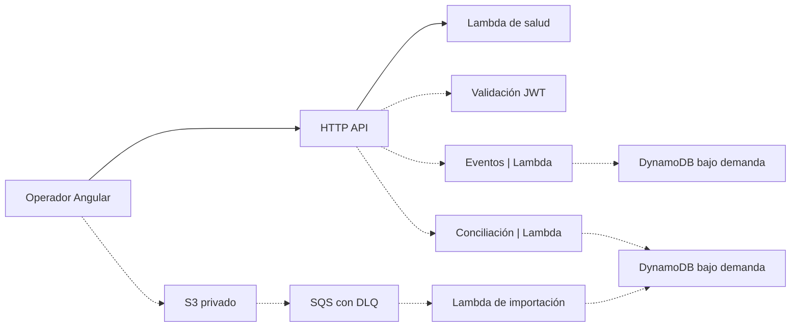

# Arquitectura de Abonos por Evento

Un organizador importa movimientos de sus canales de pago, revisa sugerencias de asignación y obtiene saldos por participante. El cierre deja un historial de movimientos aplicados, pendientes y reversados para el equipo operativo.

## Estado de la base

`infra/template.yaml` define una HTTP API con una Lambda Node.js 24 arm64 y un grupo de logs con retención marcada. Los servicios de dominio y sus recursos de datos corresponden al diseño del piloto. Las flechas punteadas del [diagrama](diagram.mmd) representan ese piloto.

## Responsabilidades y datos

| Dominio | Responsabilidad | Almacenamiento propuesto |
| --- | --- | --- |
| Eventos | Eventos, participantes, montos acordados y roles de operación | DynamoDB. Clave por organización y evento, con participantes en acceso paginado. |
| Conciliación | Batches de importación, candidatos de coincidencia, movimientos y saldos | S3 privado para archivos temporales y DynamoDB para batches, movimientos inmutables y saldos por participante. |

Eventos es dueño de participantes y montos acordados. Conciliación es dueña del ledger y de la proyección de saldo. La API acepta y consulta batches. La Lambda de importación valida estructura, tamaño, moneda e idempotencia y emite sugerencias en un proceso asíncrono. La confirmación es explícita y ejecuta una transacción DynamoDB para anexar el movimiento y actualizar el saldo. Los movimientos confirmados son inmutables y un reverso tiene su propia identidad y apunta al original.

S3 privado entrega la clave del objeto a una cola SQS Standard con DLQ. La Lambda registra el hash del archivo dentro de organización y evento. Usa reporte parcial de fallos de batch y claves estables para repetición de filas. Step Functions Standard entraría cuando un batch tenga varias etapas que necesiten historial y reanudación independiente. La revisión humana se persiste como estado del batch en DynamoDB.

## Contratos previstos

| Operación | Alcance |
| --- | --- |
| POST /v1/events/{eventId}/imports | Inicia un batch con clave de idempotencia y prepara una URL de carga acotada. |
| GET /v1/events/{eventId}/imports/{batchId} | Consulta progreso, registros rechazados y coincidencias que requieren revisión. |
| POST /v1/events/{eventId}/allocations | Confirma un abono idempotente tras verificar la pertenencia y la versión del registro. |
| POST /v1/events/{eventId}/movements/{movementId}/reversals | Crea un movimiento compensatorio enlazado al original dentro del mismo evento. |

Cada movimiento incluye moneda y un importe entero en unidades monetarias menores. El JSON los transporta como cadenas. La clave de deduplicación preferida incluye organización, evento, proveedor e identificador estable del movimiento. Para archivos repetidos se usa un hash dentro de organización y evento. Un registro sin referencia estable admite revisión manual y nunca se aplica por una coincidencia ambigua. Al confirmar, se verifica que el movimiento esté inédito o devuelto como la misma operación idempotente. Un reverso conserva la historia sin reescribir el abono.

## Angular y operación

Angular standalone con rutas lazy por flujo. Estado de pantalla en Signals locales. Estado de cada flujo en NgRx SignalStore con proveedores por ruta. Las llamadas HTTP viven en el servicio de datos de cada función. El backend decide operaciones que afecten dinero. Los eventos conservan un id de correlación para seguimiento.

En el piloto, los bundles estáticos se pueden alojar en S3 privado con CloudFront y Origin Access Control. API Gateway valida tokens de Cognito o del proveedor OIDC. La Lambda verifica pertenencia y permisos sobre cada recurso. Aplicar permisos distintos para importar, confirmar y auditar. El bucket privado usa bloqueo de acceso público, cifrado y caducidad para archivos de entrada. Los logs registran métricas y batchId, con referencias bancarias y datos de asistentes excluidos.

Los Lambdas escalan por invocación. El MVP usa DynamoDB bajo demanda y colas con límites explícitos. S3, logs y datos retenidos pueden generar cargos incluso cuando la aplicación no recibe solicitudes. Presupuestos, métricas de latencia y errores, retención y alarmas de cola se configuran por ambiente cuando se habiliten esos recursos.

## Casos de fallo a verificar

Cubrir archivos duplicados, cabeceras inválidas, parseo de decimales y moneda, duplicados entre archivos, filas ambiguas, confirmaciones concurrentes, reverso repetido, lote parcial y reintentos desde DLQ.

## Referencias

- [Lambda con Amazon SQS](https://docs.aws.amazon.com/lambda/latest/dg/with-sqs.html)
- [Transacciones DynamoDB](https://docs.aws.amazon.com/amazondynamodb/latest/developerguide/transactions.html)
- [Flujos de AWS Step Functions](https://docs.aws.amazon.com/step-functions/latest/dg/choosing-workflow-type.html)
