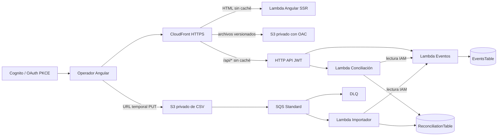

# Arquitectura de SaldoEvento

SaldoEvento usa microservicios serverless en AWS con frontend Angular servido por Lambda. El monorepo agrupa código y contratos; cada dominio conserva sus datos y función independientes.

## Unidades desplegables

| Unidad | Entrada y responsabilidad | Datos propios |
| --- | --- | --- |
| Frontend | Angular 22 SSR/Express adaptado a Lambda Node.js 24 ARM64. HTML inicial, navegación y configuración pública. | Ningún dato de negocio persistente. |
| Eventos | Lambda HTTP y contrato interno IAM: eventos, participantes, moneda e importes acordados. | EventsTable en DynamoDB bajo demanda. |
| Conciliación | Lambda HTTP: batches, confirmaciones idempotentes, ledger y saldos. | ReconciliationTable en DynamoDB bajo demanda. |
| Importador | Lambda SQS del dominio Conciliación: valida CSV y huella, persiste filas y sugerencias; no aplica abonos. | Bucket S3 privado de entrada y tabla de Conciliación. |
| Salud | `GET /health`; acredita liveness, no disponibilidad de todas las dependencias. | Ninguno. |

Eventos y Conciliación se comunican mediante un contrato de lectura explícito usando Lambda Invoke con IAM. Conciliación no puede leer ni escribir EventsTable. Compartir utilidades de validación no comparte la propiedad de los datos.

## Angular servido mediante Lambda

`web/angular.json` construye salida `server`, no una publicación exclusivamente estática. `src/main.server.ts` arranca Angular con BootstrapContext; `src/server.ts` exporta Express `app` y el manejador Angular. `scripts/package-frontend.mjs` empaqueta los bundles y `serverless-http` en `artifacts/frontend` con manifiesto verificable.

CloudFront usa Function URL `AWS_IAM` con Origin Access Control. La política de Lambda limita `InvokeFunctionUrl` e `InvokeFunction` a la distribución. El HTML y la configuración de acceso llevan `Cache-Control: no-store`; ningún token ni respuesta privada debe transferirse a otro usuario mediante caché SSR o HTTP. Los estáticos tienen origen S3 privado separado.

Se siguió el patrón existente del portafolio (`frontend-stack.js` y `tools/package-ssr-lambda.mjs`). Referencias de plataforma: [Angular SSR](https://angular.dev/guide/ssr) y [CloudFront OAC para Function URLs](https://docs.aws.amazon.com/AmazonCloudFront/latest/DeveloperGuide/private-content-restricting-access-to-lambda.html).

## Identidad y autorización

Cognito usa Authorization Code con PKCE, sin secreto de cliente. HTTP API verifica emisor y audiencia del JWT. Para esta versión, el cliente envía el ID token con `custom:organizationId` y `custom:roles`; ambos atributos los provisiona la administración, no el formulario del cliente. El servicio exige identidad y organización válidas y autoriza por rol. El cliente Cognito sólo puede escribir atributos públicos admitidos.

| Rol | Lectura | Importar | Confirmar/reversar | Crear eventos/participantes |
| --- | --- | --- | --- | --- |
| admin | Sí | Sí | Sí | Sí |
| operator | Sí | Sí | Sí | Sí |
| importer | Sí | Sí | No | No |
| confirmer | Sí | No | Sí | No |
| auditor | Sí | No | No | No |

Cada clave de almacenamiento incluye organización y evento. Una solicitud HTTP no puede convertirse en invocación interna mediante su JSON. La autenticación local sintética existe únicamente en `scripts/local-api.mjs`, enlazada a loopback; no forma parte de los handlers Lambda.

## Dinero, idempotencia e importaciones

Los importes son cadenas de enteros en unidades menores y se calculan con BigInt. El piloto admite MXN, USD y EUR. Cada evento tiene una moneda; el frontend nunca decide el saldo definitivo. Las operaciones de confirmación incluyen una versión esperada y un identificador estable. La misma operación devuelve el resultado original; cambiar su contenido produce conflicto. El proveedor y su identificador de movimiento deduplican entre archivos.

Un batch registra huella SHA-256 dentro de organización/evento y una clave de S3 estable. El worker verifica los bytes recibidos antes de producir sugerencias. Sólo una coincidencia de referencia exacta y única propone un participante. Las referencias ambiguas o sin coincidencia necesitan selección manual. El operador confirma expresamente, lo que anexa el movimiento y actualiza el saldo con control de concurrencia.

Un reverso tiene identificador propio, importe compensatorio y `reversalOf`. No modifica el abono ni permite un segundo reverso independiente del mismo movimiento. Las lecturas reconstruyen el saldo desde el ledger.

SQS entrega al menos una vez. La idempotencia admite replay y el worker usa ReportBatchItemFailures; los errores agotados pasan a DLQ. El bucket bloquea acceso público, cifra y caduca CSV; los logs no deben contener filas ni referencias personales. Los límites del piloto y la verificación AWS se registran en Operación.

## Ambientes y dominio

| Stage | Rama | URL |
| --- | --- | --- |
| dev | development | https://saldoevento-dev.lynxpardelle.com |
| test | testing | https://saldoevento-test.lynxpardelle.com |
| prod | main | https://saldoevento.lynxpardelle.com |

`infra/template.yaml` declara el subdominio y Route53/ACM mediante parámetros. CloudFront requiere el certificado en us-east-1. Las ramas se elevan **development → testing → main**. La existencia de plantillas o URLs previstas no acredita despliegue ni operación; el reporte de verificación distingue pruebas locales y cloud.
