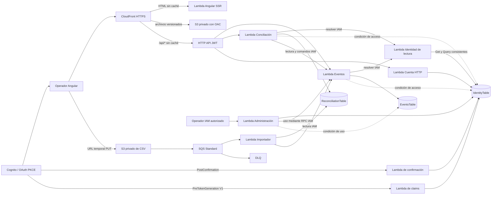

# Arquitectura de SaldoEvento

SaldoEvento usa microservicios serverless en AWS con frontend Angular servido por Lambda. El monorepo agrupa código y contratos; cada dominio conserva sus datos y función independientes.

**Estado al 19 de noviembre de 2026:** el piloto de `main` `05b02f31563d88285d22b5085d69d3ba757e6675`, promovido mediante el [PR #10](https://github.com/LynxPardelle/abonos-por-evento/pull/10), está publicado en https://saldoevento.lynxpardelle.com y validado con una cuenta real de producción. El incremento de entitlements, cierre, plantillas y Equipo descrito a continuación está **implementado y probado localmente, todavía no desplegado**. No confundir su plantilla SAM o pruebas locales con una ampliación ya disponible en producción. Stripe y Checkout siguen OFF.

## Unidades desplegables

| Unidad                          | Entrada y responsabilidad                                                                                                                                               | Datos propios                                                  |
| ------------------------------- | ----------------------------------------------------------------------------------------------------------------------------------------------------------------------- | -------------------------------------------------------------- |
| Frontend                        | Angular 22 SSR/Express adaptado a Lambda Node.js 24 ARM64. HTML inicial, navegación y configuración pública.                                                            | Ningún dato de negocio persistente.                            |
| Eventos                         | Lambda HTTP y contrato interno IAM: eventos, participantes, moneda e importes acordados; el incremento local añade cuotas, archivo, reserva de reapertura y plantillas. | EventsTable en DynamoDB bajo demanda.                          |
| Conciliación                    | Lambda HTTP: batches, confirmaciones idempotentes, ledger y saldos; el incremento local añade cierre financiero, snapshots, CSV y vista entre eventos por moneda.       | ReconciliationTable en DynamoDB bajo demanda.                  |
| Importador                      | Lambda SQS del dominio Conciliación: valida CSV y huella, persiste filas y sugerencias; no aplica abonos.                                                               | Bucket S3 privado de entrada y tabla de Conciliación.          |
| Identidad: registro             | Triggers Cognito PostConfirmation y PreTokenGeneration V1: provisión idempotente y claims de organización/rol.                                                          | IdentityTable, por pool y sujeto.                              |
| Identidad: resolver local       | Lambda IAM de lectura actual de membresía, roles, scope y plan; sin caché de permisos ni aprovisionamiento.                                                             | Sólo lectura consistente de IdentityTable.                     |
| Identidad: cuenta HTTP local    | Lambda JWT para `/me`, miembros, roles y revocación por el propietario.                                                                                                 | Membresías adicionales, versiones y bitácora en IdentityTable. |
| Identidad: administración local | Lambda sin ruta HTTP o Function URL: asignaciones manuales de evaluación y colaboradores mediante IAM.                                                                  | Plan por organización y plazas en IdentityTable.               |
| Salud                           | `GET /health`; acredita liveness, no disponibilidad de todas las dependencias.                                                                                          | Ninguno.                                                       |

Eventos y Conciliación se comunican mediante contratos explícitos usando Lambda Invoke con IAM. Las consultas y comandos sobre eventos se ejecutan en su dominio; Conciliación no consulta o modifica EventsTable directamente. Compartir utilidades de validación no comparte la propiedad de los datos.

La única excepción nueva a la separación física es una **condición de lectura de metadatos** dentro de las transacciones: Eventos/Conciliación comprueban snapshots de acceso en IdentityTable; la administración de planes comprueba versión y conteo del ítem `USAGE#EVENTS` de EventsTable. No escriben tablas ajenas. Esto hace indivisibles la decisión de acceso/cuota y el commit de cada dominio, sin confiar en un RPC previo que pueda quedar obsoleto.

## Angular servido mediante Lambda

La ruta `/` devuelve el sitio comercial, `/registro` presenta el alta del piloto y `/app` abre el espacio operativo. Los enlaces profundos de `/eventos/{eventId}/...` se conservan. `/auth/callback` completa el intercambio de código y vuelve a `/app`. El ejemplo de la landing es ilustrativo; no consulta saldos privados ni se presenta como una métrica de clientes. El incremento local incorpora las pantallas de plan, equipo, plantillas, vista global y cierre, subordinadas al contexto de organización y a las capacidades devueltas por el servidor.

`web/angular.json` construye salida `server`, no una publicación exclusivamente estática. `src/main.server.ts` arranca Angular con BootstrapContext; `src/server.ts` exporta Express `app` y el manejador Angular. `scripts/package-frontend.mjs` empaqueta los bundles y `serverless-http` en `artifacts/frontend` con manifiesto verificable.

CloudFront usa Function URL `AWS_IAM` con Origin Access Control. La política de Lambda limita `InvokeFunctionUrl` e `InvokeFunction` a la distribución. El HTML y la configuración de acceso llevan `Cache-Control: no-store`; ningún token ni respuesta privada debe transferirse a otro usuario mediante caché SSR o HTTP. Los estáticos tienen origen S3 privado separado.

Se siguió el patrón existente del portafolio (`frontend-stack.js` y `tools/package-ssr-lambda.mjs`). Referencias de plataforma: [Angular SSR](https://angular.dev/guide/ssr) y [CloudFront OAC para Function URLs](https://docs.aws.amazon.com/AmazonCloudFront/latest/DeveloperGuide/private-content-restricting-access-to-lambda.html).

## Identidad y autorización

Cognito usa Authorization Code con PKCE S256, sin secreto de cliente. La configuración pública expone si el registro está habilitado; el CTA lo respeta. `SelfRegistrationEnabled` es false por defecto y los parámetros de development/testing lo habilitan explícitamente. El lanzamiento aprobado del piloto en producción utiliza el override efectivo `true`, registrado en su comprobante; el archivo base de parámetros puede seguir cerrado por defecto. Las promociones deben revisar los parámetros efectivos. El cliente Cognito sólo puede escribir `email` y `name`, nunca organización o roles.

PostConfirmation prepara la membresía después de confirmar la cuenta o recuperar la contraseña. PreTokenGeneration V1 obtiene o repara esa membresía antes de emitir el ID token. Una cuenta nueva con correo verificado recibe una organización derivada del pool y `sub`, rol `admin` dentro de esa organización y tier `pilot`. La creación DynamoDB condicional y la lectura consistente hacen idempotente el aprovisionamiento; `clientMetadata` y el formulario no eligen tenant, rol ni plan pagado.

IdentityTable es la fuente de verdad. Los atributos protegidos de una cuenta administrativa anterior sólo se importan en su primer acceso; después, cambiar `custom:roles` en Cognito no modifica una membresía persistida. Una membresía suspendida o corrupta impide nuevos tokens. En el piloto publicado, los tokens pueden conservar acceso hasta caducar a los quince minutos. En el incremento local, los handlers AWS consultan al resolver IAM en cada petición y las escrituras comparan los snapshots de acceso en su transacción: un cambio de membresía o plan invalida los commits que aún no se habían confirmado. No se utiliza un fallback a claims antiguos si falla el resolver.

HTTP API verifica emisor y audiencia por ambiente. El incremento local valida `sub`, pool y `token_use` del ID token, y obtiene los permisos actuales del servidor. El header `X-SaldoEvento-Organization` propone una selección; sólo se acepta si existe membresía activa. La organización personal permanece disponible al incorporarse a otro equipo y no se reescriben sus filas `MEMBERSHIP` o claims de compatibilidad. Una cuenta de producción no hereda la identidad o los eventos de testing.

Los cinco manejadores de Identidad del incremento tienen fronteras distintas: los dos triggers existentes aprovisionan la membresía base; el resolver sólo tiene `GetItem/Query`; la cuenta HTTP modifica roles/baja de colaboradores con autorización del propietario; el administrador IAM asigna planes o colaboradores sin ruta pública. Los triggers conservan invocación restringida al ARN del pool y cuenta esperados. Las Lambdas de negocio pueden invocar al resolver, pero no al administrador. El CLI de evaluación sólo muestra una vista previa por defecto y exige ejecución explícita. [Detalles de Identidad](../../services/identity/README.md).

| Rol       | Lectura | Importar | Confirmar/reversar | Crear eventos/participantes |
| --------- | ------- | -------- | ------------------ | --------------------------- |
| admin     | Sí      | Sí       | Sí                 | Sí                          |
| operator  | Sí      | Sí       | Sí                 | Sí                          |
| importer  | Sí      | Sí       | No                 | No                          |
| confirmer | Sí      | No       | Sí                 | No                          |
| auditor   | Sí      | No       | No                 | No                          |

Las claves de negocio de Eventos y Conciliación incluyen organización y evento; las de Identidad incorporan pool y sujeto, en una tabla física por stack. Una solicitud HTTP no puede convertirse en invocación interna mediante su JSON. La autenticación local sintética existe únicamente en `scripts/local-api.mjs`, enlazada a loopback; no forma parte de los handlers Lambda ni crea cuentas Cognito.

Los colaboradores de Equipo reciben `operator`, `importer`, `confirmer` o `auditor`, con scope global o una lista de eventos. No reciben `admin` ni propiedad por una invitación o cambio de rol. Un scope de eventos deniega crear eventos, gestionar plantillas y consultar el agregado global. El propietario ocupa una plaza y no puede eliminarse desde las rutas de colaboradores. La baja bloquea nuevas peticiones y los commits con permisos obsoletos; una URL S3 PUT previamente firmada puede seguir vigente hasta cinco minutos, pero no confirma abonos.

## Planes de evaluación y cuotas locales

El plan se guarda en `ORG#{organizationId}/PLAN`, con catálogo y versión de asignación; el claim `custom:tier:pilot` no concede entitlements. El catálogo `2026-11-19.v1` conserva piloto sin cuota comercial de eventos; Por Evento admite 1, Organizador 5 y Equipo 20 eventos **no archivados**. Las plazas son 1/1/1/5 y cuentan propietario más todos los colaboradores activos. No hay precios, vencimientos comerciales, cobros, renovación o selección autónoma de tier.

Eventos posee el contador `ORG#{organizationId}/USAGE#EVENTS` y actualiza evento y conteo en la misma transacción. Crear o reabrir un archivado comprueba capacidad; archivar la libera; un cierre financiero sin archivo sigue contando. La administración de planes consulta uso mediante RPC IAM y condiciona su escritura a ese snapshot; no puede reducir el límite por debajo del uso concurrente. Los reintentos no consumen capacidad dos veces. Las plazas de Equipo y sus membresías adicionales se actualizan atómicamente en IdentityTable.

Una organización personal de alta verificada tiene propietario derivado del pool/sujeto. Una organización administrativa histórica puede tener varios usuarios y no se autoasigna propietario o base de una plaza. Conserva su acceso básico; Equipo estricto queda bloqueado hasta una migración IAM explícita de esa base. No se copian o resetean membresías históricas para activar un plan.

[PLANES.md](../PLANES.md) distingue las capacidades locales de la oferta publicada. Equipo sólo admite altas manuales IAM a sujetos existentes y gestión posterior por el propietario; las invitaciones con enlace o correo y Stripe están diferidos. Las tarjetas comerciales no activan funciones o cargos.

## Dinero, idempotencia e importaciones

Los importes son cadenas de enteros en unidades menores y se calculan con BigInt. El piloto admite MXN, USD y EUR. Cada evento tiene una moneda; el frontend nunca decide el saldo definitivo. Las operaciones de confirmación incluyen una versión esperada y un identificador estable. La misma operación devuelve el resultado original; cambiar su contenido produce conflicto. El proveedor y su identificador de movimiento deduplican entre archivos.

Un batch registra huella SHA-256 dentro de organización/evento y una clave de S3 estable. El worker verifica los bytes recibidos antes de producir sugerencias. Sólo una coincidencia de referencia exacta y única propone un participante. Las referencias ambiguas o sin coincidencia necesitan selección manual. El operador confirma expresamente, lo que anexa el movimiento y actualiza el saldo con control de concurrencia.

Un reverso tiene identificador propio, importe compensatorio y `reversalOf`. No modifica el abono ni permite un segundo reverso independiente del mismo movimiento. Las lecturas reconstruyen el saldo desde el ledger.

SQS entrega al menos una vez. La idempotencia admite replay y el worker usa ReportBatchItemFailures; los errores agotados pasan a DLQ. El bucket bloquea acceso público, cifra y caduca CSV; los logs no deben contener filas ni referencias personales. Los límites del piloto y la verificación AWS se registran en Operación.

## Cierre, archivo, reportes y plantillas locales

Conciliación es dueña de `financialStatus`, `lifecycleVersion`, snapshots `CLOSURE#...` y operaciones de reapertura. El cierre captura saldos, movimientos, totales, actor/fecha y revisión del padrón; snapshot y estado cerrado se escriben en una sola transacción con versiones y condiciones de acceso. Su tamaño máximo es 300000 bytes; el exceso se rechaza antes de cerrar. El cierre es financiero: bloquea nuevas aplicaciones de pagos hasta reabrir, pero no equivale a cerrar las inscripciones o congelar el padrón de Eventos.

Eventos es dueño del archivo y de la reserva `reopening`. Archivar exige cierre financiero y revisión vigente. Reabrir un archivado primero reserva cuota, después abre el ledger mediante CAS y finalmente elimina la reserva con `finalizeReopen`. Si se pierde una respuesta, la misma operación y la transición persistida permiten recuperar una reserva existente o la finalización pendiente. No se ejecuta otra reserva ni se duplica el movimiento. Cerrar/reabrir un ledger vacío conserva la versión cero y permite el primer pago posterior con comparación explícita de versión.

Un cierre histórico es inmutable incluso si luego cambia el padrón. Su reporte sigue consultable después de un downgrade mientras la persona conserve acceso al evento. El CSV, de hasta 1 MiB, usa BOM UTF-8, CRLF, escape de comillas y protección de celdas de texto frente a fórmulas. Conserva importes grandes y negativos sin convertir a `Number`. Los registros antiguos pueden no tener actor o fecha; no se presenta como una auditoría completa.

Eventos conserva plantillas de hasta 90 participantes y 300000 bytes. Aplicarlas crea un evento y participantes nuevos, con versión de plantilla, cuota y condiciones de acceso en una transacción; no copia pagos, movimientos o saldos. La vista de Conciliación entre eventos incluye sólo no archivados, admite hasta 50 y suma por moneda mediante `BigInt`, sin mezclar divisas o introducir tipos de cambio.

## Ambientes y dominio

| Stage | Rama        | URL                                       |
| ----- | ----------- | ----------------------------------------- |
| dev   | development | https://saldoevento-dev.lynxpardelle.com  |
| test  | testing     | https://saldoevento-test.lynxpardelle.com |
| prod  | main        | https://saldoevento.lynxpardelle.com      |

`infra/template.yaml` declara el subdominio y Route53/ACM mediante parámetros. CloudFront requiere el certificado en us-east-1. La elevación es **development → testing → main**, mediante PR, merge commits y verificaciones sobre el HEAD esperado. Las ramas de trabajo se integran primero en development. `scripts/Deploy-Testing.ps1` exige el commit remoto promovido y un artefacto con checksums coincidentes. [Procedimiento de testing](../runbooks/testing-promotion.md).

La existencia de una plantilla o URL prevista no acredita despliegue. El piloto publicado tiene evidencia de CI, comprobante de producción, verificación pública y aceptación humana; véase [VERIFICACION.md](../VERIFICACION.md). Los artefactos de cada ambiente se conservan bajo `artifacts/deployments/{dev,test,prod}` y la aceptación de producción bajo `artifacts/acceptance/prod-2026-11-19`, sin credenciales o tokens. El nuevo incremento aún debe recorrer sus verificaciones y promoción: la aceptación del piloto anterior no acredita que estas funciones nuevas ya estén publicadas.
