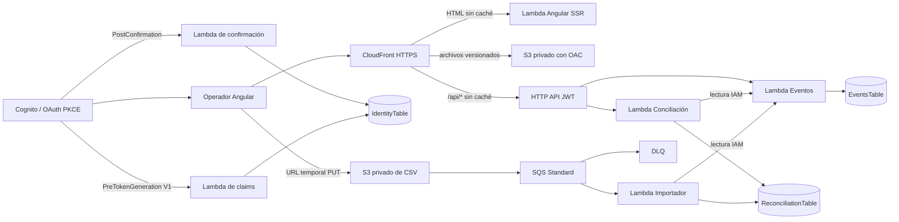

# Arquitectura de SaldoEvento

SaldoEvento usa microservicios serverless en AWS con frontend Angular servido por Lambda. El monorepo agrupa código y contratos; cada dominio conserva sus datos y función independientes.

## Unidades desplegables

| Unidad | Entrada y responsabilidad | Datos propios |
| --- | --- | --- |
| Frontend | Angular 22 SSR/Express adaptado a Lambda Node.js 24 ARM64. HTML inicial, navegación y configuración pública. | Ningún dato de negocio persistente. |
| Eventos | Lambda HTTP y contrato interno IAM: eventos, participantes, moneda e importes acordados. | EventsTable en DynamoDB bajo demanda. |
| Conciliación | Lambda HTTP: batches, confirmaciones idempotentes, ledger y saldos. | ReconciliationTable en DynamoDB bajo demanda. |
| Importador | Lambda SQS del dominio Conciliación: valida CSV y huella, persiste filas y sugerencias; no aplica abonos. | Bucket S3 privado de entrada y tabla de Conciliación. |
| Identidad | Triggers Cognito PostConfirmation y PreTokenGeneration V1: provisión idempotente y claims de organización/rol. | IdentityTable, por pool y sujeto. |
| Salud | `GET /health`; acredita liveness, no disponibilidad de todas las dependencias. | Ninguno. |

Eventos y Conciliación se comunican mediante un contrato de lectura explícito usando Lambda Invoke con IAM. Conciliación no puede leer ni escribir EventsTable. Compartir utilidades de validación no comparte la propiedad de los datos.

## Angular servido mediante Lambda

La ruta `/` devuelve el sitio comercial, `/registro` presenta el alta del piloto y `/app` abre el espacio operativo. Los enlaces profundos de `/eventos/{eventId}/...` se conservan. `/auth/callback` completa el intercambio de código y vuelve a `/app`. El ejemplo de la landing es ilustrativo; no consulta saldos privados ni se presenta como una métrica de clientes.

`web/angular.json` construye salida `server`, no una publicación exclusivamente estática. `src/main.server.ts` arranca Angular con BootstrapContext; `src/server.ts` exporta Express `app` y el manejador Angular. `scripts/package-frontend.mjs` empaqueta los bundles y `serverless-http` en `artifacts/frontend` con manifiesto verificable.

CloudFront usa Function URL `AWS_IAM` con Origin Access Control. La política de Lambda limita `InvokeFunctionUrl` e `InvokeFunction` a la distribución. El HTML y la configuración de acceso llevan `Cache-Control: no-store`; ningún token ni respuesta privada debe transferirse a otro usuario mediante caché SSR o HTTP. Los estáticos tienen origen S3 privado separado.

Se siguió el patrón existente del portafolio (`frontend-stack.js` y `tools/package-ssr-lambda.mjs`). Referencias de plataforma: [Angular SSR](https://angular.dev/guide/ssr) y [CloudFront OAC para Function URLs](https://docs.aws.amazon.com/AmazonCloudFront/latest/DeveloperGuide/private-content-restricting-access-to-lambda.html).

## Identidad y autorización

Cognito usa Authorization Code con PKCE S256, sin secreto de cliente. La configuración pública expone si el registro está habilitado; el CTA lo respeta. `SelfRegistrationEnabled` es false por defecto y los parámetros de development/testing lo habilitan explícitamente. Producción permanece cerrada mientras `main` espera la aceptación del propietario. El cliente Cognito sólo puede escribir `email` y `name`, nunca organización o roles.

PostConfirmation prepara la membresía después de confirmar la cuenta o recuperar la contraseña. PreTokenGeneration V1 obtiene o repara esa membresía antes de emitir el ID token. Una cuenta nueva con correo verificado recibe una organización derivada del pool y `sub`, rol `admin` dentro de esa organización y tier `pilot`. La creación DynamoDB condicional y la lectura consistente hacen idempotente el aprovisionamiento; `clientMetadata` y el formulario no eligen tenant, rol ni plan pagado.

IdentityTable es la fuente de verdad. Los atributos protegidos de una cuenta administrativa anterior sólo se importan en su primer acceso; después, cambiar `custom:roles` en Cognito no modifica una membresía persistida. Una membresía suspendida o corrupta impide nuevos tokens. La API acepta tokens válidos hasta su caducidad de 15 minutos y no consulta la tabla en cada petición, por lo que no hay revocación inmediata de tokens ya emitidos. No existe una API pública de administración de membresías o invitaciones.

HTTP API verifica emisor y audiencia. El backend exige el ID token con `custom:organizationId` y `custom:roles` emitidos por el servidor y autoriza cada recurso por rol. Los triggers sólo pueden invocarse por Cognito con el ARN del pool y la cuenta esperados; sus roles IAM sólo leen/escriben IdentityTable y no acceden a tablas financieras. [Detalles de Identidad](../../services/identity/README.md).

| Rol | Lectura | Importar | Confirmar/reversar | Crear eventos/participantes |
| --- | --- | --- | --- | --- |
| admin | Sí | Sí | Sí | Sí |
| operator | Sí | Sí | Sí | Sí |
| importer | Sí | Sí | No | No |
| confirmer | Sí | No | Sí | No |
| auditor | Sí | No | No | No |

Las claves de negocio de Eventos y Conciliación incluyen organización y evento; las de Identidad incorporan pool y sujeto, en una tabla física por stack. Una solicitud HTTP no puede convertirse en invocación interna mediante su JSON. La autenticación local sintética existe únicamente en `scripts/local-api.mjs`, enlazada a loopback; no forma parte de los handlers Lambda ni crea cuentas Cognito.

El campo tier del piloto es metadato de la membresía, no un motor de cuotas ni facturación. [PLANES.md](../PLANES.md) conserva las propuestas comerciales; los entitlements, las invitaciones y Stripe permanecen pendientes y no se activan desde las tarjetas de la landing.

## Dinero, idempotencia e importaciones

Los importes son cadenas de enteros en unidades menores y se calculan con BigInt. El piloto admite MXN, USD y EUR. Cada evento tiene una moneda; el frontend nunca decide el saldo definitivo. Las operaciones de confirmación incluyen una versión esperada y un identificador estable. La misma operación devuelve el resultado original; cambiar su contenido produce conflicto. El proveedor y su identificador de movimiento deduplican entre archivos.

Un batch registra huella SHA-256 dentro de organización/evento y una clave de S3 estable. El worker verifica los bytes recibidos antes de producir sugerencias. Sólo una coincidencia de referencia exacta y única propone un participante. Las referencias ambiguas o sin coincidencia necesitan selección manual. El operador confirma expresamente, lo que anexa el movimiento y actualiza el saldo con control de concurrencia.

Un reverso tiene identificador propio, importe compensatorio y `reversalOf`. No modifica el abono ni permite un segundo reverso independiente del mismo movimiento. Las lecturas reconstruyen el saldo desde el ledger.

SQS entrega al menos una vez. La idempotencia admite replay y el worker usa ReportBatchItemFailures; los errores agotados pasan a DLQ. El bucket bloquea acceso público, cifra y caduca CSV; los logs no deben contener filas ni referencias personales. Los límites del piloto y la verificación AWS se registran en Operación.

## Ambientes y dominio

| Stage | Rama | URL |
| --- | --- | --- |
| dev | development | https://saldoevento-dev.lynxpardelle.com |
| test | testing | https://saldoevento-test.lynxpardelle.com |
| prod | main | https://saldoevento.lynxpardelle.com |

`infra/template.yaml` declara el subdominio y Route53/ACM mediante parámetros. CloudFront requiere el certificado en us-east-1. La entrega pasa por PR **feature → development → testing**, con merge commits en la promoción y verificaciones sobre el HEAD esperado. `scripts/Deploy-Testing.ps1` exige el commit remoto promovido y un artefacto con checksums coincidentes. [Procedimiento de testing](../runbooks/testing-promotion.md).

La existencia de una plantilla o URL prevista no acredita despliegue. Los resultados de esta entrega se consultan en los PR, CI y reportes `artifacts/deployments/{dev,test}/cloud-smoke.json`. El historial documentado de la base anterior permanece separado. **No se promueve a `main` ni se publica producción hasta la prueba del propietario con su cuenta y una instrucción posterior.**
